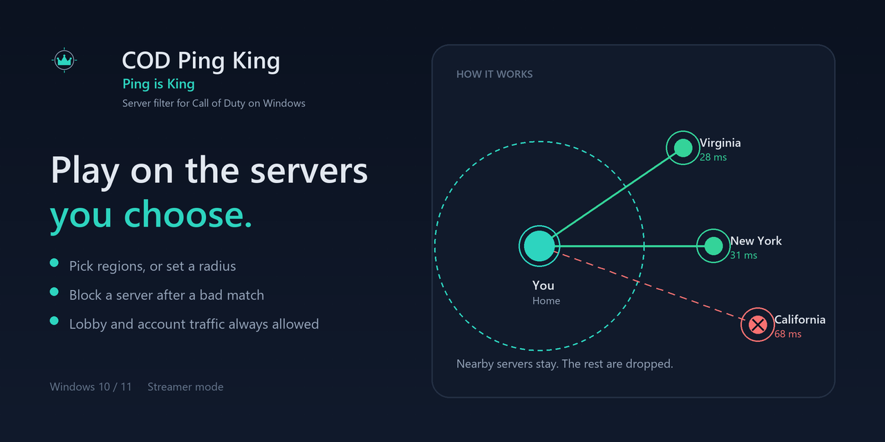
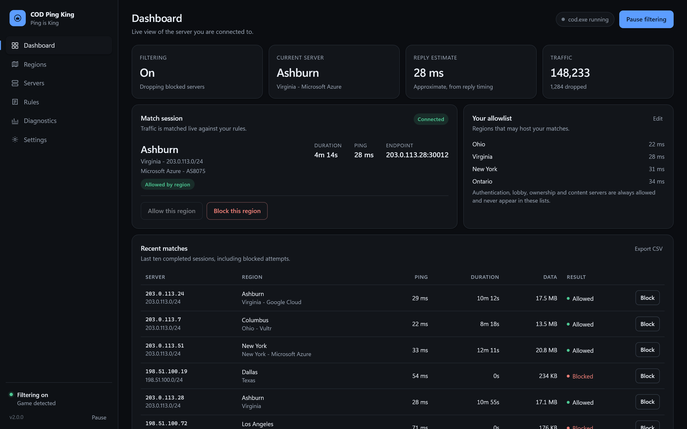
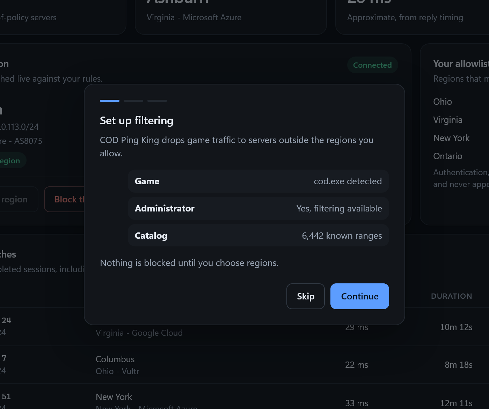
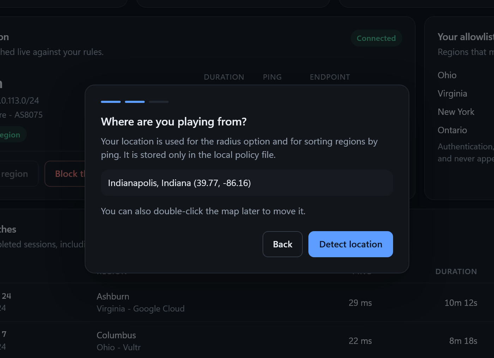
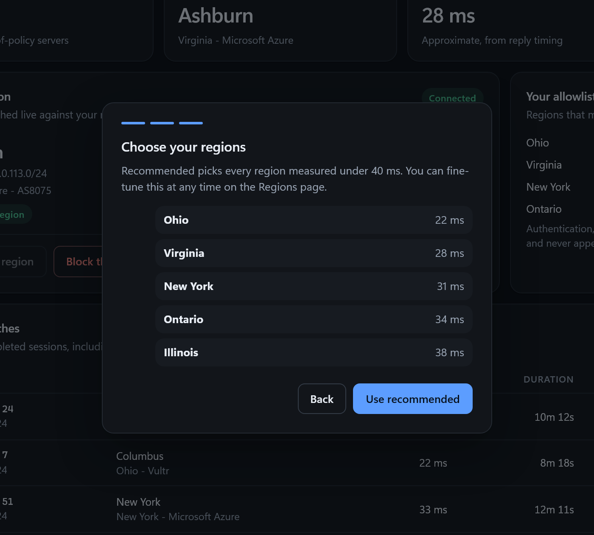
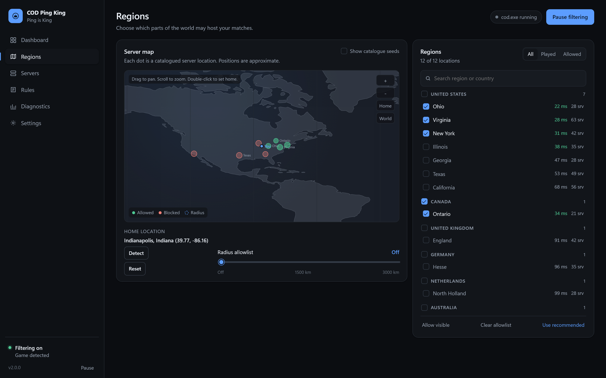
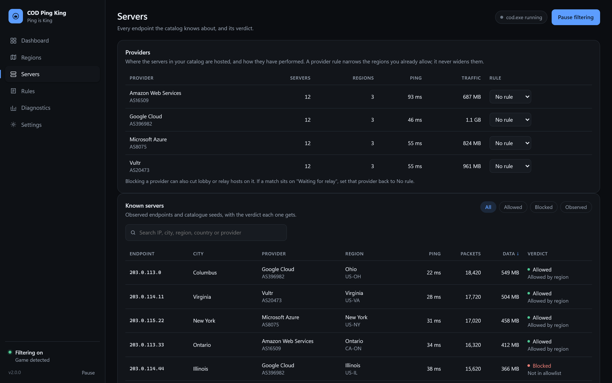
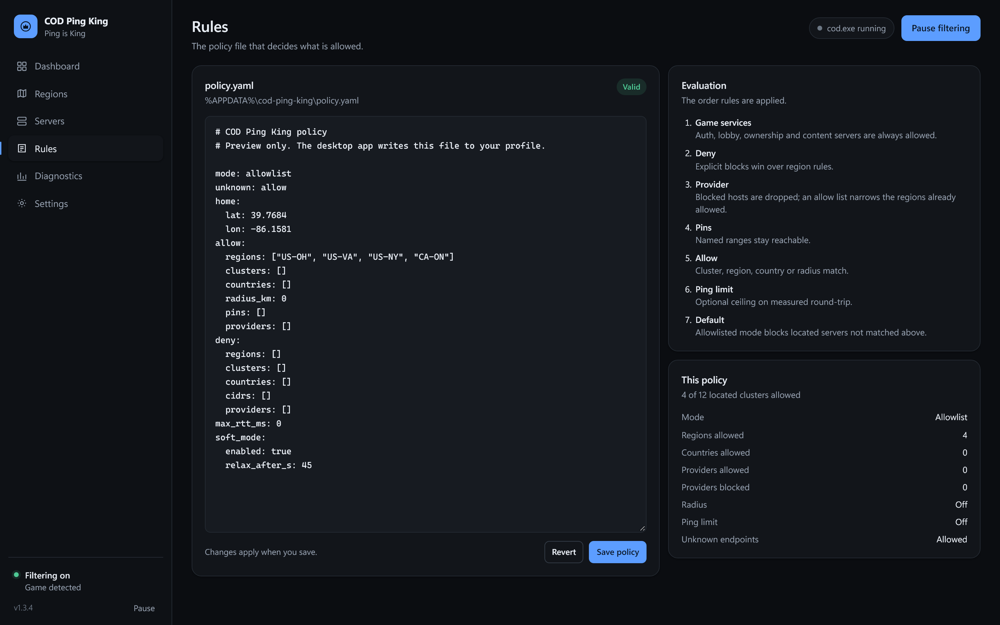
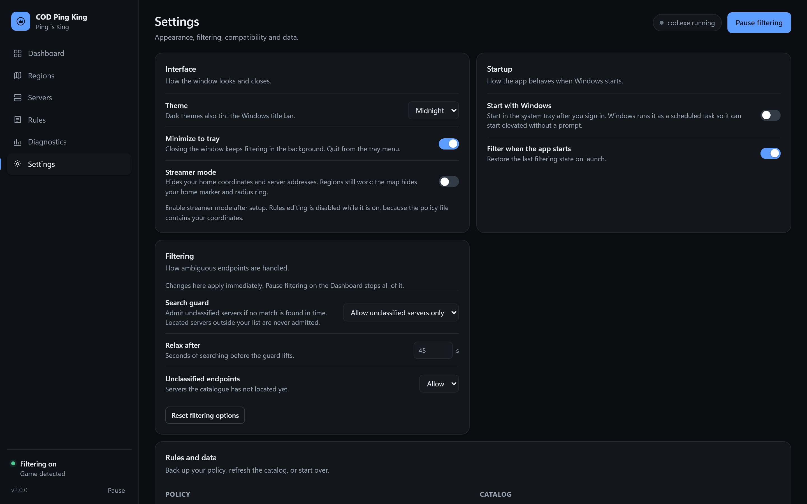
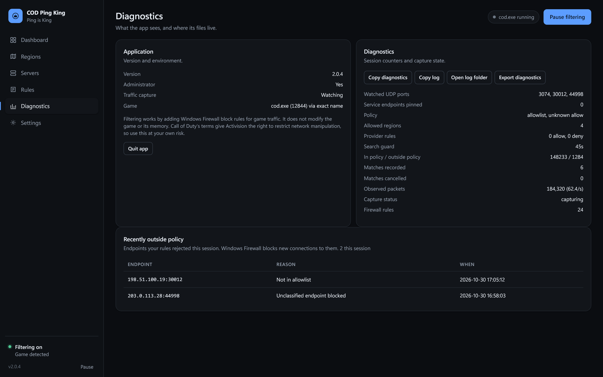

<p align="center">
  
</p>

# COD Ping King (PiK)

**Ping is King**

I built this because the game kept putting me on servers I did not want, and
there was no setting to change that. COD Ping King (PiK) filters Call of Duty's
UDP traffic on Windows: you choose the regions you will play on, and traffic to
everything else is dropped.

It is not a VPN, and it does not modify the game or read its memory. It watches
the game's sockets with WinDivert, works out which server a match is using, and
drops the rest.

<p align="center">
  <a href="docs/screenshots/dashboard.png"></a>
</p>

## What it does

- Allow or block regions and cities, or set a radius around your home.
- Block a match's server with one click. It becomes a /24 deny rule and applies
  to the next search.
- Authentication, lobby, ownership and CDN endpoints are always allowed and stay
  out of the server lists.
- Streamer mode hides your location and server addresses for screenshots and
  recordings. Closing the window keeps filtering in the tray.

It does not change how the game rates you, only which servers are reachable. If
your bracket has nobody nearby, the search guard relaxes the filter instead of
leaving you searching; you can raise the delay or turn it off in Settings.

## Requirements

- Windows 10 or 11, 64-bit.
- WebView2. Windows 11 ships with it; on Windows 10 it usually arrives with Edge.
  If the window opens blank, install the WebView2 Runtime from Microsoft.
- Administrator rights. The packet driver needs them, and the app asks on launch.
- Call of Duty installed. Any title from Modern Warfare (2019) onward: the app
  matches `cod.exe` as well as prefixed builds such as `cod25-cod.exe`, so a
  renamed executable is still detected.

## Install

1. Download `COD-Ping-King-1.3.4.exe` from the releases page.
2. Run it and allow the administrator prompt.
3. Pick desktop and Start menu shortcuts if you want them.
4. Launch the app. The setup wizard opens the first time.

The app installs to `Program Files\COD Ping King`. Settings, policy and catalog
live in your Windows user profile, so reinstalling keeps them.

## Setup, step by step

Click any screenshot to open the full-resolution version.

### 1. Check the basics

The first screen confirms that the app is running elevated, that the packet
driver loaded, and that the catalog is ready.

<a href="docs/screenshots/setup-1.png"></a>

If that check fails, close the app and start it with **Run as administrator**.
Without elevation it can still watch traffic, but it cannot filter.

### 2. Set your home location

Click **Detect location**, or click your area on the map. The radius and the
recommendations measure from this point. You can change or reset it later on
Regions.

<a href="docs/screenshots/setup-2.png"></a>

The lookup goes to [ipwho.is](https://ipwho.is) over HTTPS. Nothing else about you
is sent.

### 3. Accept the recommended regions

The wizard lists the closest regions it knows about, with ping where it has a
measurement. Uncheck anything you would not play on, then click **Use
recommended**. That switches the policy to allowlist mode and blocks servers it
has not classified yet. The search guard is the way out if the list is too tight.

<a href="docs/screenshots/setup-3.png"></a>

Start the game and play a match.

## Using it

### Dashboard

The dashboard shows filtering state, the current server with its city and
provider, the deciding rule, latency and traffic, and recent matches. Latency is
an estimate from reply timing. A server cannot reply faster than its tick rate,
so the number bottoms out near 16 ms even when the route is longer. **Block** adds
a match's server to the deny list; the same button turns into **Unblock**.

### Regions

The map shows catalogued servers as dots: green for allowed, red for blocked.
The list on the right is grouped by country and shows the observed ping for each
region. The slider sets a radius in kilometres; everything inside is allowed.
Drag to pan, scroll to zoom, and double-click to set home.

<a href="docs/screenshots/regions.png"></a>

In allowlist mode, checking a region allows it. In blocklist mode, checking a
region blocks it and everything else stays reachable. The header and the allowlist
card both show which mode you are in.

### Servers

This lists everything the app has seen or imported: city, provider, region,
ping, bytes, verdict and when it was last seen. Search by city, address or
provider, filter by verdict, sort any column. The CSV export contains the same
rows.

The **Providers** card groups the catalog by hosting company, with server count,
regions covered, observed ping and traffic. Each row can be **No rule**, **Allow
only** or **Block**. A provider rule narrows the regions you already allow; it
does not widen them, and a block beats an allow. Ranges with no provider pass.
Game services ignore provider rules, and so does Steam relay traffic, since a
block can otherwise leave a lobby on "Waiting for relay".

<a href="docs/screenshots/servers.png"></a>

### Rules

A live editor for the policy YAML. Bad YAML is rejected with a line number, and
the evaluation order sits next to the editor. The same file can be exported and
imported under Settings.

<a href="docs/screenshots/rules.png"></a>

### Settings

**Interface** has theme, window behaviour and streamer mode. **Minimize to tray**
is on by default; turn it off if the close button should exit.

**Startup** registers a logon task that runs elevated and minimized. A Run key
cannot show a UAC prompt at sign-in, so the task is the only way to start hidden.

**Filtering** has the search guard, its delay and the rule for unclassified
endpoints. **Reset filtering options** restores those and the blocking scope.
**Blocking scope** sits under Advanced because Strict can break matchmaking:
Safe drops listed servers on first contact, Strict drops anything the rules
reject.

**Compatibility** is for titles that misbehave. **Attach to the game** waits for
UDP sockets to settle before intercepting, about ten seconds after launch; the
wait happens once per launch. **Unload driver on exit** stops the WinDivert
service on quit. **Leave port 3074 alone**, under Advanced, stops watching the
main socket and leaves most matches unfiltered.

**Rules and data** combines policy export and import with catalog refresh, CSV
and discovered-server export, the data folder and catalog reset.

<a href="docs/screenshots/settings.png"></a>

### Diagnostics

Diagnostics lists version, elevation, driver state,
watched ports, service pins, packet counters, intercepted rate, handle reopens,
scope and match count. Copy diagnostics, Copy log, Open log folder and Export
diagnostics sit at the top; Export writes the same text to Documents. Endpoints
blocked this session are in their own table with reason and time.

The log records startup settings, policy loads and saves, match starts and ends,
and blocked endpoints. Scan bursts are collapsed into one line, and Copy log
includes the previous rotation when the current file is short.

Ctrl+1 through Ctrl+6 switch screens, Ctrl+F focuses search, and Ctrl+Alt+P
toggles filtering without leaving the game.

<a href="docs/screenshots/diagnostics.png"></a>

## How a packet is decided

Outbound UDP from the game is intercepted; inbound is only sniffed. Every
outbound packet on the game's ports is checked in this order:

1. **Game service pin** - always allow. Auth, lobby, ownership and CDN.
2. **Deny rules** - ranges, clusters, regions, countries or providers.
3. **Allow pins** - addresses you added yourself.
4. **Allow rules** - regions, clusters or countries.
5. **Provider allow** - if the list is not empty, only those hosts pass. Pins
   are exempt.
6. **Radius** - clusters inside the circle around home.
7. **Ping limit** - optional maximum estimated RTT.
8. **Default** - allow or deny endpoints that are not in the catalog.
9. **Scope** - safe scope drops any located server the rules reject at the first
   packet, waits for a session before dropping endpoints the catalog has not
   located, and never treats platform traffic as a match. Strict drops anything
   the rules reject.

A denied outbound packet is dropped without a reset. The game sees a dead
endpoint and picks another one, and the server is never told it was refused.

Only outbound packets are held for a decision. Inbound copies are read in sniff
mode, which the driver delivers without removing them, so the game's receive
path never waits for the app. The sniffer closes while a match is live and
resumes when it ends, which keeps the packet path light.

Safe scope is the default because lobby and party traffic often uses cloud
addresses that no server list contains, and because the game pings every
candidate before choosing. A located server your rules reject is dropped on its
first packet, so it never answers. An unlocated endpoint is dropped only once a
flow looks like a real session. A range that hosts a match is remembered as a
server, and the search guard timer restarts after a minute of quiet.

Traffic on port 3074, Steam networking and relay ports (27000-27199) and STUN
ports (3478, 4379-4380) is control traffic and is not dropped automatically.
Provider blocks do not override that, but explicit denies do, including the
block button on a match. Strict is the older behaviour: drop everything the
rules reject, at the cost of occasional matchmaking failures.

Auth, lobby, ownership and CDN addresses are resolved at launch and refreshed
every ten minutes. If one is ever blocked, Diagnostics shows the endpoint and
reason, and the log keeps a rate-limited line per address.

If the app exits or crashes, the driver closes and Windows routes normally again.
There are no firewall rules left behind.

## Server data

The bundled catalog comes from two community lists,
[Geomate](https://github.com/hudra0/geomate) and
[cod-server-list](https://github.com/zFF2/cod-server-list) (September 2026),
geolocated with [ip-api](https://ip-api.com), plus whatever the app observes on
your machine. Nearby addresses are grouped into clusters, and a cluster is what
you allow or deny.

cod-server-list also records the ASN and organisation for each address, so most
ranges arrive with a provider attached. Geomate only carries an organisation name
from the original lookup. Names are collapsed onto the four families that host
most Call of Duty servers (Google Cloud, Microsoft Azure, Amazon Web Services,
Vultr) plus the smaller hosts that appear in the lists.

**Settings -> Update from public lists** pulls the current versions and merges new
ranges without overwriting what the app has already learned.

## Privacy and streamer mode

The app shows your home coordinates and the addresses of servers you connect to.
Either is enough to work out roughly where you live, so both are on screen by
default.

**Settings -> Streamer mode** hides:

- home coordinates and the map marker and ring,
- server addresses in the current match, the Servers table and recent matches,
- policy text, its path and diagnostic paths,
- Block and Unblock buttons, so a masked address cannot be submitted.

Filtering and region selection keep working. Policy editing and export are
disabled while it is on because the YAML contains your coordinates. Turn streamer
mode on after setup; the wizard needs your real location.

The app talks to two services, both optional: ipwho.is for location lookups
(home and newly observed ranges) and GitHub for public list updates. Location
lookups also return the network operator for that address, which is how the
Servers screen knows who hosts it. There is no telemetry and no account.

## Troubleshooting

**"Administrator required" banner.** Close the app and start it again elevated.
The installer launches it elevated, but a shortcut you made yourself may not.

**Game not detected.** It matches `cod.exe`, `cod_hq.exe`, `modernwarfare.exe`,
`blackopscoldwar.exe`, `warzone.exe`, and any `<prefix>-cod.exe` build such as
`cod24-cod.exe` or `cod25-cod.exe`. Campaign executables (`sp24-cod.exe`) are
ignored on purpose. Start the game first; the process list is checked while
filtering runs, and **Diagnostics** shows which file was matched.

**A game closes or refuses to launch while filtering is on.** Set **Settings ->
Compatibility -> Attach to the game** to **Immediately** and try again. The
default waits for the game's UDP ports to settle so the first packets of a launch
are not intercepted; a few titles open sockets late. If it still closes, turn on
**Leave port 3074 alone**, which exempts the main socket the game shares with its
lobby traffic. Quit the app (it unloads the driver) and report which title and
where it stopped.

**The wizard recommends nothing.** It needs a home location and at least one
located cluster. Run **Settings -> Update from public lists**, then try again. A
fresh catalog has no reply-time data, so the wizard falls back to distance and
server count.

**Stuck searching.** Check that at least one region is still allowed. The search
guard lets unclassified endpoints through after 45 seconds, but it cannot help if
every catalogued server near you is denied. Widen the radius or add a region.

**Stuck on "Waiting for relay".** Relay and lobby hosts run on the same hosting
providers as match servers, so a provider block can cut the relay and leave the
loading screen waiting. Set that provider back to **No rule**. Steam relay traffic
on ports 27000-27199 is exempt by default; an explicit deny on one of those
addresses still applies.

**"Unable to connect to online services."** Something is blocking a service
endpoint. Game services are pinned at startup; if the host list could not be
resolved (offline DNS, VPN), restart the app with the network connected. Do not
add Demonware or CDN addresses to a deny list.

**The installer cannot replace files.** Setup now stops the WinDivert driver
service before copying and asks you to close a running window. If it still
reports access denied on `WinDivert64.sys`, reboot and run it again; the driver
stays loaded until the service is gone.

**"Packet driver unavailable" banner.** Click **Retry driver** first. If that
fails, the error text under **Diagnostics** names the reason; copy it when
asking for help. Reinstalling fixes a missing driver file. Antivirus software
that quarantines `WinDivert64.sys` also produces this.

## Limitations

- **Coverage varies by title.** The newest release will have endpoints the
  catalog has not located yet. Safe scope waits for a session before dropping
  those; strict mode blocks them from the first packet.
- **Safe scope is a trade.** A range absent from every list, and never used for a
  match, can carry the first second of traffic before it is dropped and
  remembered. Strict refuses it immediately but can break matchmaking.
- **Provider rules need a provider.** Ranges with no ASN or organisation in the
  bundled lists pass provider rules because there is nothing to compare. Provider
  names are only as accurate as the list snapshot.
- **Geolocation is approximate.** Game servers run on cloud providers whose IPs
  often report a provider headquarters. Clustering nearby addresses helps, but a
  city label can still be wrong.
- **Ping is estimated** from packet gaps, not read from the game. It can differ
  from the in-game number. It is only a hard rule if you enable the ping limit.
- **IPv6 is handled at /48**, IPv4 at /24. A provider that rotates across many
  /24s looks unclassified until the app sees it.
- **Public lists go stale.** They are community snapshots, not an official server
  directory.
- **Anti-cheat and terms of service.** The app does not read game memory, inject
  code or change game files. It filters packets, the same way a firewall does.
  Activision's terms still leave them free to restrict access, so keep that in
  mind.
- **Windows only.** The driver and tray integration are Windows-specific.

## Why not Windows Firewall

Windows Firewall checks explicit block rules before allow rules, so it cannot say
"allow these regions and drop the rest" without listing every address to block.
Cloud ranges rotate, which makes a static blocklist unreliable. WinDivert can do
a real allowlist and releases cleanly when the app exits.

## Build from source

Python 3.11 or newer on Windows. From a clone or the source archive:

```bat
python -m venv .venv
.venv\Scripts\activate
pip install -r requirements.txt
```

Run it:

```bat
python main.py
```

`run.bat` does the same thing and changes to the repository folder first. Run it
as administrator if you want filtering; without elevation it only catalogs.

The first launch writes a policy and seeds the catalog from the bundled lists. To
look at the interface without the game or driver:

```bat
python main.py --preview
```

Tests:

```bat
python -m pytest tests -q
```

Build the one-folder executable:

```bat
python -m PyInstaller packaging\build.spec --noconfirm
```

Output: `dist\COD Ping King\CODPingKing.exe`. Keep the whole folder; the exe does
not run on its own.

Build the installer with [Inno Setup 6](https://jrsoftware.org/isinfo.php):

```bat
"%LOCALAPPDATA%\Programs\Inno Setup 6\ISCC.exe" packaging\installer.iss
```

Output: `dist\installer\COD-Ping-King-1.3.4.exe`. Close a running copy before
rebuilding into `dist`, or Windows locks the bundled DLLs. If that happens, build
to `dist-next` and pass `/DDistDir=..\dist-next` to ISCC.

The logo and banner are generated from code:

```bat
python tools\build_brand.py
```

## Where data lives

| What | Path |
| --- | --- |
| Policy | `%APPDATA%\cod-ping-king\policy.yaml` |
| Settings | `%APPDATA%\cod-ping-king\config.json` |
| Catalog | `%LOCALAPPDATA%\cod-ping-king\catalog.db` |
| Log | `%LOCALAPPDATA%\cod-ping-king\app.log` (rotated at 1 MB, 3 files) |
| Policy export | `%USERPROFILE%\Documents\cod-ping-king-policy-<timestamp>.yaml` |

Nothing is written to the install folder, so updating the app does not touch your
regions or match history.

## Uninstall

Use the entry in Windows Settings or the Start menu. The uninstaller asks whether
to delete your data; answer No to keep your regions, catalog and history for a
later install.

## Project layout

```
cod_region_filter/
  app.py       entry point, window and tray wiring
  api.py       JS-to-Python bridge
  capture.py   WinDivert capture and verdict enforcement
  catalog.py   SQLite range catalog and clustering
  catalog_update.py  public list download and parsing
  engine.py    flow tracking, match detection, search guard
  games.py     process and UDP port discovery
  geo.py       HTTPS geolocation
  hotkey.py    global pause shortcut
  paths.py     per-user data locations and migration
  policy.py    YAML policy and evaluation
  services.py  service endpoint resolution
  startup.py   logon task registration
  state.py     application state
  titlebar.py  native title bar colours
  tray.py      system tray icon and menu
  ui/          HTML/CSS/JS interface
data/          seed ranges and community list
docs/          brand assets and screenshots
packaging/     PyInstaller spec, version info, Inno Setup script
tests/         unit tests
tools/         seed, geolocation and brand build scripts
```

## Socials & Donations

[Discord](https://discord.com/invite/dc74er8TJF) - [YouTube](https://www.youtube.com/c/Hybred) - [Twitter/X](https://x.com/TheHybred)

This tool is free and always will be. If it saves you time, you can help cover the hardware, tools and games used for testing:

<p align="center">
  <a href="https://www.patreon.com/c/Hybred"></a>
  &nbsp;&nbsp;
  <a href="https://ko-fi.com/hybred"></a>
</p>

## Trademark

Not affiliated with or endorsed by Activision Publishing, Inc. Call of Duty is a
trademark of Activision Publishing, Inc. This project ships no game assets and
uses no Call of Duty logos.


