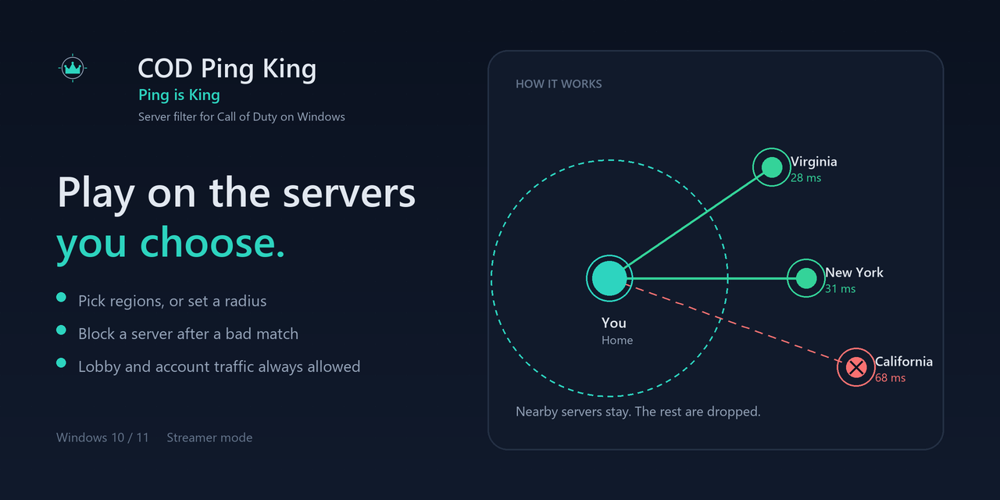
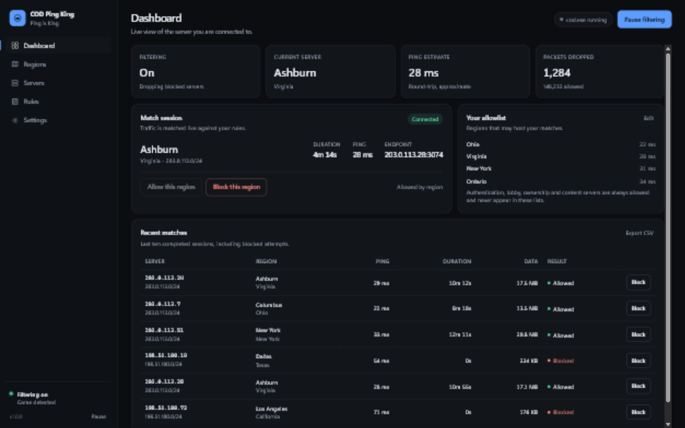
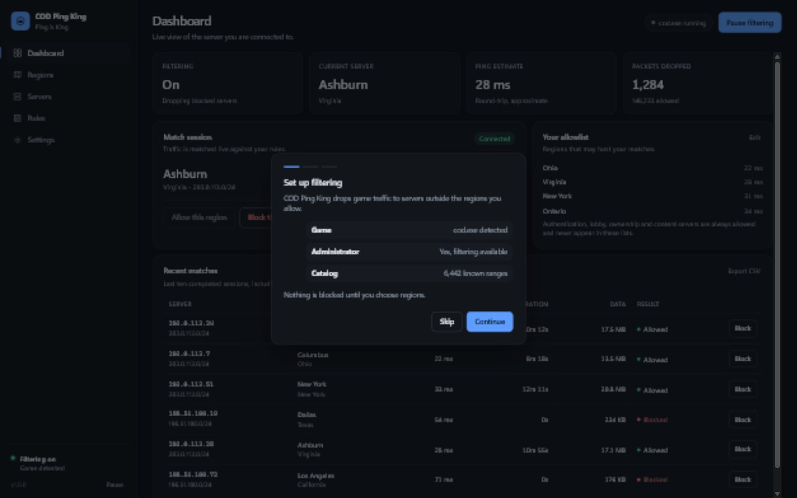
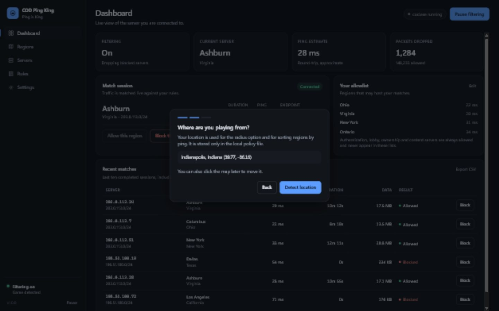
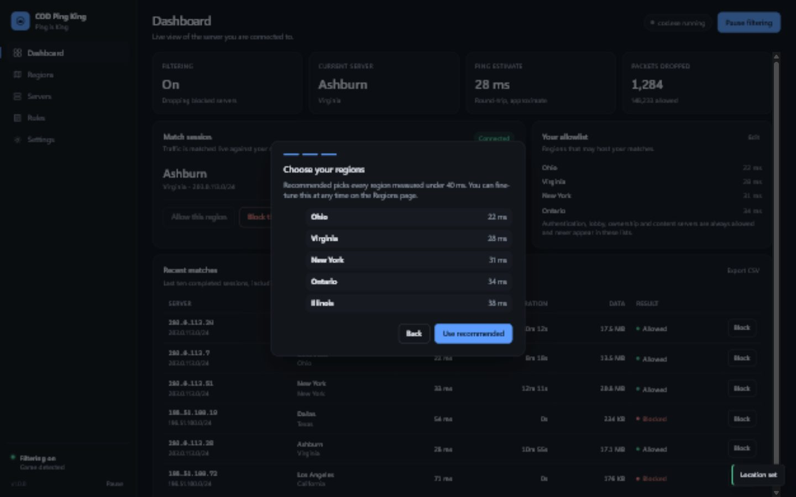
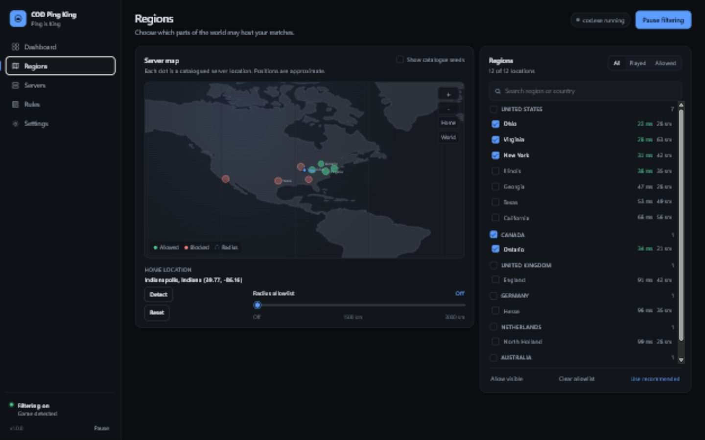
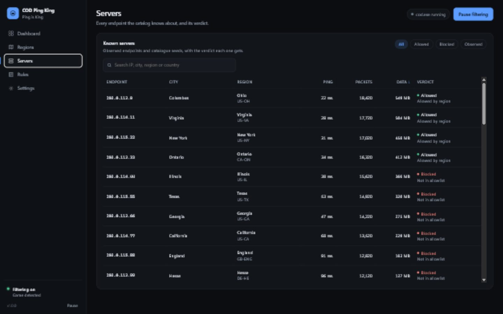
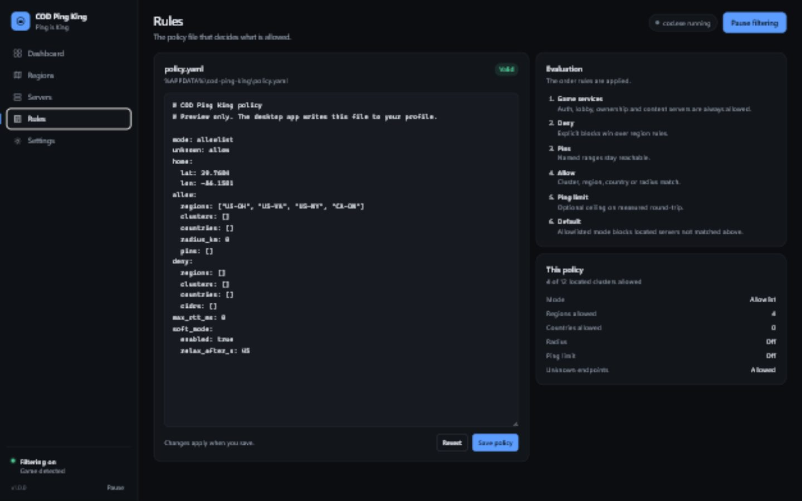
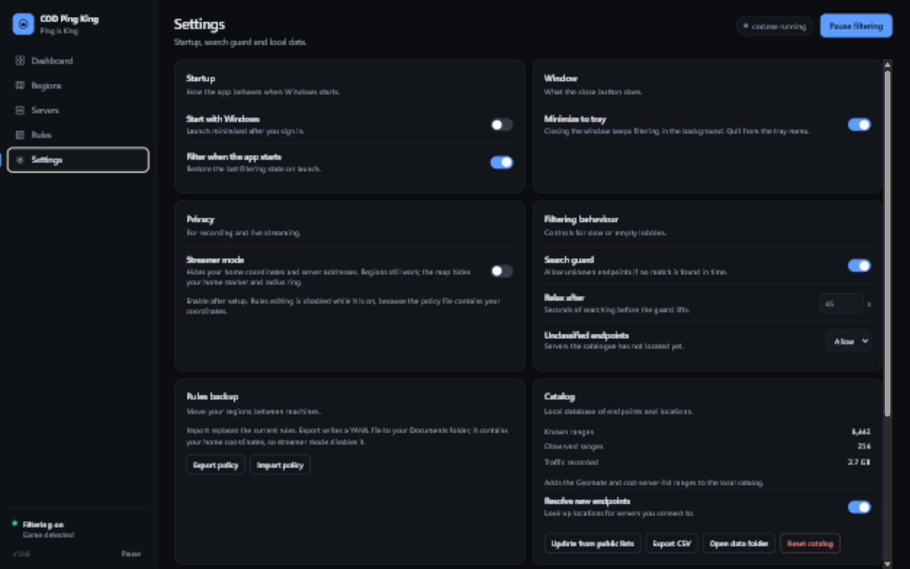

<p align="center">
  
</p>

# COD Ping King

**Ping is King**

I built this because the game kept putting me on servers I did not want, and
there was no setting to tell it otherwise. It is a packet filter for Call of Duty
on Windows: you choose the regions you are willing to play on, and traffic to
everything else is dropped.

It is not a VPN. It does not modify the game or read its memory. The app watches
the game's UDP traffic with WinDivert, works out which server the match is using,
and drops packets to servers outside your rules. The game sees a dead endpoint
and searches again.

<p align="center">
  
</p>

## What it does

- Allow or block regions and cities, or set a radius around your home.
- Block the server from your last match with one click. It is added to the deny
  list as a /24 and applies from the next search.
- Authentication, lobby, ownership and CDN endpoints are resolved at startup and
  always allowed. They do not show up in the server lists.
- If a search runs past 45 seconds, unclassified endpoints are let through so a
  narrow policy cannot leave you stuck in the lobby.
- Streamer mode hides your location and server addresses for screenshots and
  recordings.
- Closing the window keeps filtering in the background. Quit from the tray or
  Settings.

Matchmaking has its own idea of where you should play, and this does not change
how the game rates you. It only limits which servers are reachable. If the
closest servers have nobody in your bracket, the search guard will eventually
relax the filter rather than leave you searching forever.

## Requirements

- Windows 10 or 11, 64-bit.
- WebView2. Windows 11 ships with it; on Windows 10 it usually arrives with Edge.
  The installer offers it if it is missing.
- Administrator rights. The packet driver needs them, and the app asks on launch.
- Call of Duty installed. Modern Warfare 4 is what I tested against, but the same
  approach should work on other recent titles.

## Install

1. Download `COD-Ping-King-1.0.0.exe` from the releases page.
2. Run it and allow the administrator prompt.
3. Pick desktop and Start menu shortcuts if you want them.
4. Launch the app. The setup wizard opens the first time.

The app installs to `Program Files\COD Ping King`. Your settings, policy and
catalog live in your Windows user profile, so reinstalling does not wipe them.

## Setup, step by step

### 1. Check the basics

The first screen confirms that the app is running elevated, that the packet
driver loaded, and that the catalog is ready.



If the administrator check fails, close the app and start it with **Run as
administrator**. It still opens without elevation, but it can only watch traffic;
it cannot filter.

### 2. Set your home location

Click **Detect location**, or click your area on the map. The coordinates give
the radius and the recommendations something to measure from. You can change or
reset this later on the Regions screen.



The lookup goes to [ipwho.is](https://ipwho.is) over HTTPS. Nothing else about you
is sent.

### 3. Accept the recommended regions

The wizard lists the closest regions it knows about, with ping where it has a
measurement. Uncheck anything you would not play on, then click **Use
recommended**. That switches the policy to allowlist mode and blocks servers it
has not classified yet. The search guard is the way out if the list is too tight.



Start the game and play a match.

## Using it

### Dashboard

Shows whether filtering is running, the server you are on, its city, an estimated
ping, packet counts and recent matches. **Block** on a match adds that server to
the deny list. The same button turns into **Unblock**.

### Regions

The map shows catalogued servers as dots: green for allowed, red for blocked.
Click the map to move your home. The list on the right is grouped by country and
shows the observed ping for each region. The slider sets a radius in kilometres;
everything inside is allowed.



In allowlist mode, checking a region allows it. In blocklist mode, checking a
region blocks it and everything else stays reachable. The header and the allowlist
card both show which mode you are in.

### Servers

Everything the app has seen or imported: city, region, ping, bytes, verdict and
when it was last seen. Search by city or address, filter by verdict, sort any
column. The CSV export contains the same rows.



### Rules

A live editor for the policy YAML. Bad YAML is rejected with a line number, and
the evaluation order sits next to the editor. The same file can be exported and
imported under Settings.



### Settings

Startup, window behaviour, streamer mode, filtering behaviour, rules backup,
catalog refresh, diagnostics and the quit button. **Minimize to tray** is on by
default; turn it off if you want the close button to exit.



## How a packet is decided

Every UDP packet on the game's ports is checked in this order:

1. **Game service pin** - always allow. Auth, lobby, ownership and CDN.
2. **Deny rules** - ranges, clusters, regions or countries.
3. **Allow pins** - addresses you added yourself.
4. **Allow rules** - regions, clusters or countries.
5. **Radius** - clusters inside the circle around home.
6. **Ping limit** - optional maximum estimated RTT.
7. **Default** - allow or deny endpoints that are not in the catalog.

A denied outbound packet is dropped without a reset. The game sees a dead
endpoint and picks another one, and the server is never told it was refused.

If the app exits or crashes, the driver closes and Windows routes normally again.
There are no firewall rules left behind.

## Server data

The bundled catalog comes from two community lists,
[Geomate](https://github.com/hudra0/geomate) and
[cod-server-list](https://github.com/zFF2/cod-server-list) (September 2026),
geolocated with [ip-api](https://ip-api.com), plus whatever the app observes on
your machine. Nearby addresses are grouped into clusters, and a cluster is what
you allow or deny.

**Settings -> Update from public lists** pulls the current versions and merges new
ranges without overwriting what the app has already learned.

## Privacy and streamer mode

The app shows your home coordinates and the addresses of servers you connect to.
Either is enough to work out roughly where you live, so both are on screen by
default.

**Settings -> Streamer mode** hides:

- home coordinates and the map marker and ring,
- server addresses in the current match, the Servers table and recent matches,
- policy text, its path and diagnostic paths,
- Block and Unblock buttons, so a masked address cannot be submitted.

Filtering and region selection keep working. Policy editing and export are
disabled while it is on because the YAML contains your coordinates. Turn streamer
mode on after setup; the wizard needs your real location.

The app talks to three places, all optional: ipwho.is for location lookups,
ipwho.is again for newly observed server ranges, and GitHub for the public list
download. There is no telemetry and no account.

## Troubleshooting

**"Administrator required" banner.** Close the app and start it again elevated.
The installer launches it elevated, but a shortcut you made yourself may not.

**Game not detected.** It looks for `cod.exe`, `cod_hq.exe`, `modernwarfare*.exe`,
`mw4.exe`, `warzone.exe` and the Black Ops names. Start the game first; the process
list is checked while filtering runs.

**The wizard recommends nothing.** It needs a home location and at least one
located cluster. Run **Settings -> Update from public lists**, then try again. A
fresh catalog has no measured ping, so the wizard falls back to distance and
server count.

**Stuck searching.** Check that at least one region is still allowed. The search
guard lets unclassified endpoints through after 45 seconds, but it cannot help if
every catalogued server near you is denied. Widen the radius or add a region.

**"Unable to connect to online services."** Something is blocking a service
endpoint. Game services are pinned at startup; if the host list could not be
resolved (offline DNS, VPN), restart the app with the network connected. Do not
add Demonware or CDN addresses to a deny list.

**The installer cannot replace files.** The app is still running, maybe in the
tray or under another user. Quit it first.

**Two tray icons, or Quit does nothing.** Fixed in 1.0.0: a single-instance mutex
stops a second copy, and Quit exits on a separate thread so the tray menu cannot
block it. If an older build is still running, end it once from Task Manager.

## Limitations

- **Modern Warfare 4 coverage is unverified.** Early sessions will contain
  endpoints the catalog has not located. The wizard blocks those by default; the
  search guard is the exception.
- **Geolocation is approximate.** Game servers run on cloud providers whose IPs
  often report a provider headquarters. Clustering nearby addresses helps, but a
  city label can still be wrong.
- **Ping is estimated** from packet gaps, not read from the game. It can differ
  from the in-game number. It is only a hard rule if you enable the ping limit.
- **IPv6 is handled at /48**, IPv4 at /24. A provider that rotates across many
  /24s looks unclassified until the app sees it.
- **Public lists go stale.** They are community snapshots, not an official server
  directory.
- **Anti-cheat and terms of service.** The app does not read game memory, inject
  code or change game files. It filters packets, the same way a firewall does.
  Activision's terms still leave them free to restrict access, so keep that in
  mind.
- **Windows only.** The driver and tray integration are Windows-specific.

## Why not Windows Firewall

Windows Firewall checks explicit block rules before allow rules, so it cannot say
"allow these regions and drop everything else" without listing every address to
block. Server ranges rotate inside cloud providers, which makes a static blocklist
unreliable. WinDivert can do a real allowlist, and it releases cleanly when the app
exits.

## Build from source

Python 3.11 or newer on Windows. From a clone or the source archive:

```bat
python -m venv .venv
.venv\Scripts\activate
pip install -r requirements.txt
```

Run it:

```bat
python main.py
```

`run.bat` does the same thing and changes to the repository folder first. Run it
as administrator if you want filtering; without elevation it only catalogs.

The first launch writes a policy and seeds the catalog from the bundled lists. To
look at the interface without the game or driver:

```bat
python main.py --preview
```

Tests:

```bat
python -m pytest tests -q
```

Build the one-folder executable:

```bat
python -m PyInstaller packaging\build.spec --noconfirm
```

Output: `dist\COD Ping King\CODPingKing.exe`. Keep the whole folder; the exe does
not run on its own.

Build the installer with [Inno Setup 6](https://jrsoftware.org/isinfo.php):

```bat
"%LOCALAPPDATA%\Programs\Inno Setup 6\ISCC.exe" packaging\installer.iss
```

Output: `dist\installer\COD-Ping-King-1.0.0.exe`. Close a running copy before
rebuilding into `dist`, or Windows locks the bundled DLLs. If that happens, build
to `dist-next` and pass `/DDistDir=..\dist-next` to ISCC.

The logo and banner are generated from code:

```bat
python tools\build_brand.py
```

## Where data lives

| What | Path |
| --- | --- |
| Policy | `%APPDATA%\cod-ping-king\policy.yaml` |
| Settings | `%APPDATA%\cod-ping-king\config.json` |
| Catalog | `%LOCALAPPDATA%\cod-ping-king\catalog.db` |
| Log | `%LOCALAPPDATA%\cod-ping-king\app.log` (rotated at 1 MB, 3 files) |
| Policy export | `%USERPROFILE%\Documents\cod-ping-king-policy-<timestamp>.yaml` |

Nothing is written to the install folder, so updating the app does not touch your
regions or match history.

## Uninstall

Use the entry in Windows Settings or the Start menu. The uninstaller asks whether
to delete your data; answer No to keep your regions, catalog and history for a
later install.

## Project layout

```
cod_region_filter/
  app.py       entry point, window and tray wiring
  api.py       JS-to-Python bridge
  capture.py   WinDivert capture and verdict enforcement
  catalog.py   SQLite range catalog and clustering
  catalog_update.py  public list download and parsing
  engine.py    flow tracking, match detection, soft mode
  geo.py       HTTPS geolocation
  games.py     process and UDP port discovery
  policy.py    YAML policy and evaluation
  services.py  service endpoint resolution
  state.py     application state
  tray.py      system tray icon and menu
  ui/          HTML/CSS/JS interface
data/          seed ranges and community list
docs/          brand assets and screenshots
packaging/     PyInstaller spec, version info, Inno Setup script
tests/         unit tests
tools/         seed, geolocation and brand build scripts
```

## Trademark

Not affiliated with or endorsed by Activision Publishing, Inc. Call of Duty is a
trademark of Activision Publishing, Inc. This project ships no game assets and
uses no Call of Duty logos.
